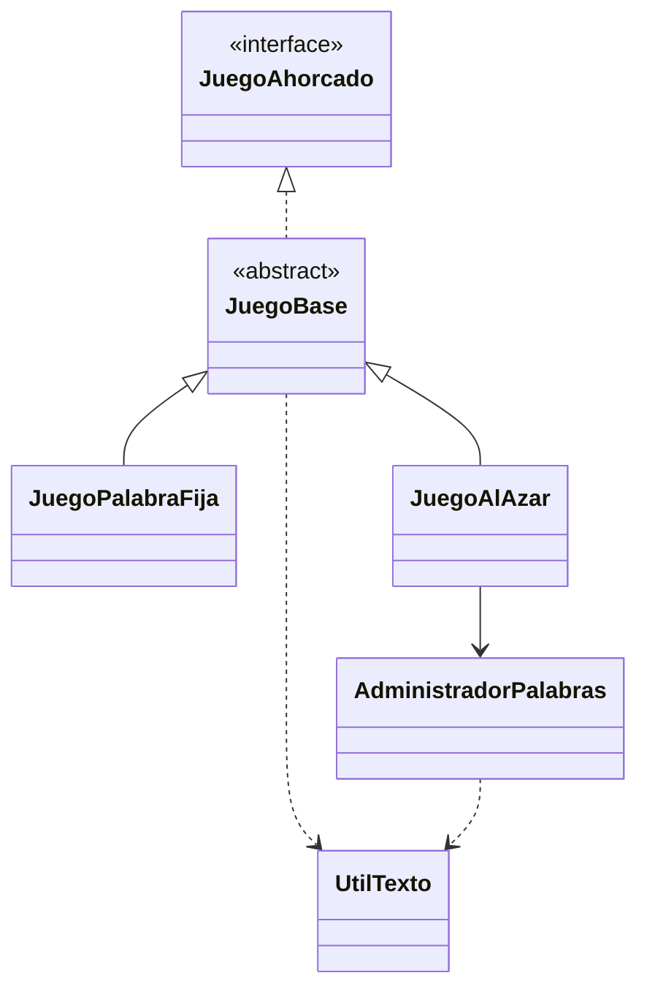

# Juego del Ahorcado

**Trabajo práctico de Programación II**

### Integrantes
- Ashly Martinez
- Rodrigo Hernandez
- Angili Palacios

### 1. Reglas de validación

Para el funcionamiento del juego se establecieron las siguientes reglas:

- No se diferencian mayúsculas y minúsculas; todas las letras se convierten a mayúsculas.
- Se ignoran las tildes y la diéresis.
- La Ñ se conserva y se considera diferente de la N.
- Se permiten únicamente letras de la A a la Z y la Ñ.
- Las palabras deben tener entre 3 y 15 letras, sin espacios, números ni símbolos.
- Cada intento debe contener una sola letra.
- No se permiten letras repetidas y estas no descuentan intentos.

### 2. Diagrama de clases

### 3. Uso de Serializable

Se implementa `Serializable` en las clases del modelo que lo requieren. Esta es una interfaz marcadora, es decir, no contiene métodos que deban implementarse, sino que indica que los objetos pueden ser serializados.

Se utiliza para cumplir con el requisito del trabajo, aunque no se guardan partidas en archivos. Por eso no se utilizan archivos `.dat`, `.ser` ni flujos de serialización.

Las clases que contienen referencias a otros objetos serializables también deben cumplir con este requisito.

---

**Programación II — Juego del Ahorcado**
